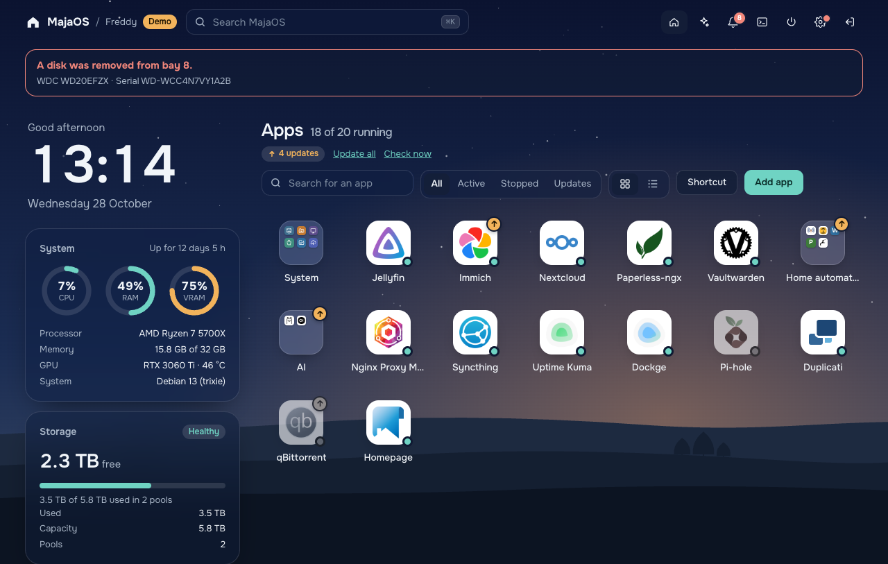
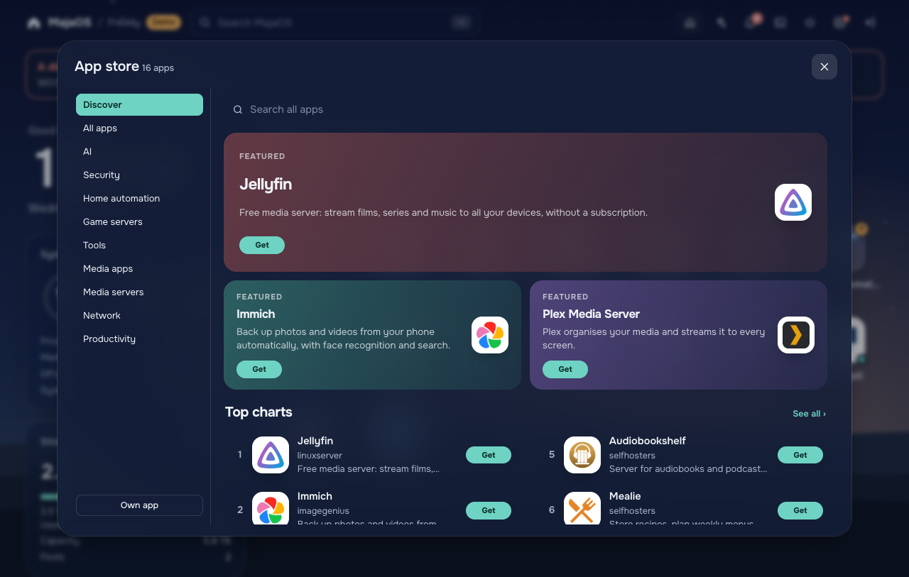
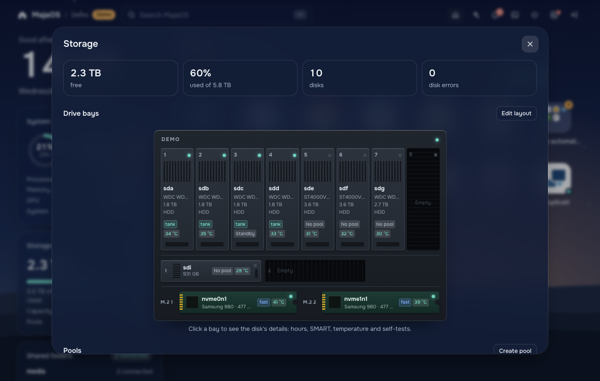
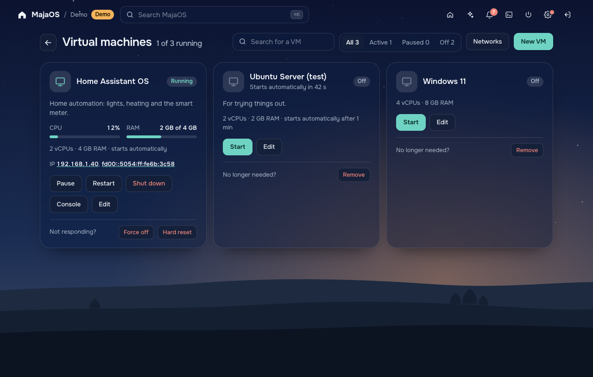
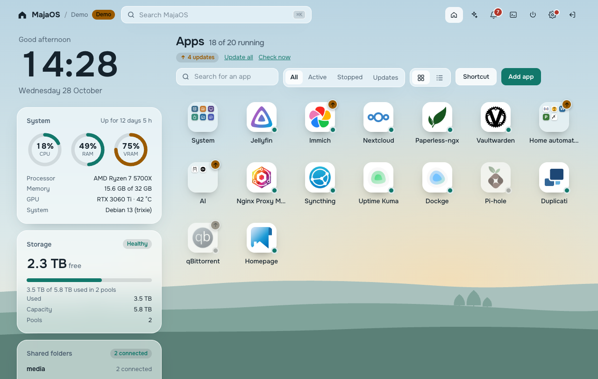

<div align="center">

# MajaOS

**A friendly dashboard for your home server.**<br>
Storage, apps, virtual machines and backups on plain Debian, without the command line.

[Try the demo](#try-it-in-two-minutes) · [Install](#install-on-a-server) · [User guide](docs/guide.md) · [Help test](#help-test-majaos) · [Contribute](CONTRIBUTING.md)

<a href="https://ko-fi.com/lennertvh"></a>



</div>

> [!WARNING]
> **MajaOS is early software.** It runs as root and manages your disks. Most of it has been tested in the demo, in virtual machines and with sample output of the real tools, but not yet on many real servers. Try it on a test machine or in a VM, not on a server with data you can't lose. That is exactly where [your help](#help-test-majaos) comes in.

## What it is

MajaOS turns a fresh **Debian 13** machine into a home server you manage from the browser. It sits on top of proven open-source building blocks and doesn't hide them:

| | Built on | What you do in MajaOS |
|---|---|---|
| **Storage** | ZFS | Create pools with a picture of what you keep and what may fail, see disk health, temperatures and SMART, place disks in a drawing of your case |
| **Apps** | Docker Compose | Install from almost 4000 apps (the Unraid Community Apps catalogue) or any image, update with one click, logs, console and settings in a form |
| **Virtual machines** | KVM / libvirt | Create Linux, Windows 11 or Home Assistant OS VMs, console in the browser, USB and PCI passthrough, snapshots, start on boot with a delay |
| **Shared folders** | Samba | Users and groups with rights per folder, Time Machine, Windows *Previous Versions* from hourly ZFS snapshots |
| **Backups** | rclone, Kopia | Your PCs and Macs to the server, the server to Google Drive, OneDrive, Dropbox, S3 or another NAS, apps and VMs to a folder |
| **AI** | Ollama, LM Studio, llama.cpp, LocalAI or Claude | A chat that checks and manages the server for you, with a local model on your own GPU or with Claude; and an MCP address so Claude Desktop, Cursor or VS Code can do the same |

And around it: two-step sign-in, HTTPS out of the box, network and Docker network settings with automatic rollback, Debian and MajaOS updates from the dashboard, a root terminal (off unless you want it), light and dark themes, and ten interface languages.

<table>
<tr>
<td width="50%"><br><sub><b>App store</b>: search, pick, install. MajaOS writes the compose file.</sub></td>
<td width="50%"><br><sub><b>Storage</b>: pools, disks and your drive bays, with SMART details per disk.</sub></td>
</tr>
<tr>
<td width="50%"><br><sub><b>Virtual machines</b>: live CPU and RAM, console, snapshots.</sub></td>
<td width="50%"><br><sub><b>Light theme</b>: morning mist. Dark is evening.</sub></td>
</tr>
</table>

## Try it in two minutes

The whole interface runs in your browser with sample data. No server, no Docker, no install: you only need [Node.js](https://nodejs.org) 18.11 or newer.

```bash
git clone https://github.com/lennertvh1/MajaOS.git
cd MajaOS
npm run demo
```

Open <http://localhost:8080>. The demo starts like a new server with the welcome wizard; the demo password is `demo`. Nothing you do there touches your computer. The installer screens are at <http://localhost:8080/install.html>.

## Install on a server

You need a 64-bit PC (UEFI, Secure Boot off) with an internet connection, and a disk MajaOS may erase for the system. Your data disks are separate.

1. Download `majaos-<version>-amd64.iso` from the [latest release](https://github.com/lennertvh1/MajaOS/releases), or [build it yourself](docs/build-iso.md).
2. Write it to a USB stick with [balenaEtcher](https://etcher.balena.io) and boot from it.
3. Pick your language and the disk, tick the NVIDIA driver if you have such a card, and choose **Erase and install**.
4. After the restart MajaOS sets itself up (5 to 15 minutes). The address appears on the server's screen. Open it in a browser and create your account.

Your browser warns about the certificate the first time: MajaOS uses its own. *Settings → Security* explains how to trust it on each device.

Prefer to start from your own Debian 13? `sudo ./install.sh` does the same on an existing install. See the [user guide](docs/guide.md#installing-by-hand).

## Help test MajaOS

The most useful thing right now is people running MajaOS on real hardware and telling what happens. Good things to try:

- **The installer** on a real PC or in Proxmox, Unraid, VirtualBox or VMware (UEFI): does it start, can you click, does the installation finish?
- **The first boot**: does MajaOS set itself up and show its address?
- **Your real disks**: creating a pool, SMART details, temperatures, a disk in standby.
- **Apps** from the app store you actually use, and their web addresses.
- **VMs**, especially Home Assistant OS, Windows 11 and GPU or USB passthrough.
- **Backups** to a real cloud account, and the backup app on a PC or Mac.

Found something? [Open an issue](https://github.com/lennertvh1/MajaOS/issues/new/choose) with the *Test report* or *Bug report* form. Screenshots and the output of `journalctl -u majaos -e` help a lot. Security problems go through [private reporting](SECURITY.md), not a public issue.

## Contribute

Fixes, translations and new features are welcome. Read [CONTRIBUTING.md](CONTRIBUTING.md) first; in short:

- Fork the repository, make a branch from **`dev`**, and open a pull request to `dev`.
- No build step and no npm dependencies: plain Node.js on the server, plain HTML, CSS and JavaScript in the browser.
- `npm test` and the demo must keep working. Every endpoint the server has, the demo has too (`public/demo.js`).
- Code, comments and docs are in English. Interface text goes through `t()` and gets a translation in `public/lang/`.

**A new language** is one file: copy `public/lang/nl.js`, translate the values and add it to `public/lang/languages.js`.

## How it fits together

```
Browser ──HTTPS──▶ server.js (Node.js, no dependencies, runs as root on Debian 13)
                     ├─ lib/storage.js, zpool.js, disks.js    → zpool, zfs, lsblk, smartctl
                     ├─ lib/docker.js, appstore.js            → Docker API, docker compose
                     ├─ lib/vms.js, vmhw.js, vmnet.js         → virsh, qemu-img, virt-install
                     ├─ lib/shares.js, backup.js, kopia.js    → Samba, rclone, Kopia
                     └─ lib/auth.js, tls.js, ...              → accounts, two-step sign-in, certificates
public/              → the interface (app.js), the demo adapter (demo.js), translations (lang/)
iso/                 → the installation ISO and its graphical installer
```

Every system command goes through one function without a shell, and the parsers are tested with real output of the tools. [CLAUDE.md](CLAUDE.md) describes every module in detail.

## Status and roadmap

MajaOS is developed in the open on the `dev` branch; `main` only holds released versions. What is known to be untested on real hardware is listed under *Known uncertainties* in [CLAUDE.md](CLAUDE.md). Ideas for what comes next: notifications (failing disk, degraded pool, failed backup), managing datasets and snapshots, extending a pool and replacing a disk, a second app catalogue, and Let's Encrypt certificates for your own domain.

## Support MajaOS

MajaOS is free and made in spare time. If it's useful to you and you'd like to help it along, you can buy me a coffee on [Ko-fi](https://ko-fi.com/lennertvh). Testing it and reporting what you find helps just as much.

## License

MajaOS is released under the [MIT License](LICENSE).

It includes [noVNC](https://github.com/novnc/noVNC) 1.7.0 (MPL-2.0, with pako under MIT) in `public/vendor/novnc` and [xterm.js](https://xtermjs.org) 6.0.0 with addon-fit (MIT) in `public/vendor/xterm`, both unchanged. The app store downloads the [Unraid Community Apps](https://github.com/Squidly271/AppFeed) catalogue at runtime; it is not part of this repository.
